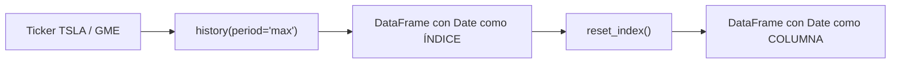

# 1 · Precios históricos con yfinance



## Qué hay que entender
- Un **ticker** es el símbolo de una empresa en bolsa (Tesla = `TSLA`, GameStop = `GME`).
- `history(period="max")` trae todo el histórico disponible: `Open, High, Low, Close, Volume, Dividends, Stock Splits`.
- La fecha llega como **índice**; con `reset_index()` pasa a ser una columna normal, imprescindible para graficar y filtrar.
- Se quita la zona horaria (`tz_localize(None)`) para poder comparar con las fechas de ingresos, que no la tienen.

## Código
```python
import yfinance as yf
tesla_data = yf.Ticker("TSLA").history(period="max").reset_index()
tesla_data.head()
```

## Errores típicos
| Síntoma | Causa | Solución |
|---|---|---|
| `KeyError: 'Date'` | Falta `reset_index()` | Aplicarlo tras `history()` |
| Tabla vacía | Sin internet o ticker mal escrito | Comprobar conexión y símbolo |
| Error al comparar fechas | Una serie tiene zona horaria y la otra no | `dt.tz_localize(None)` |
