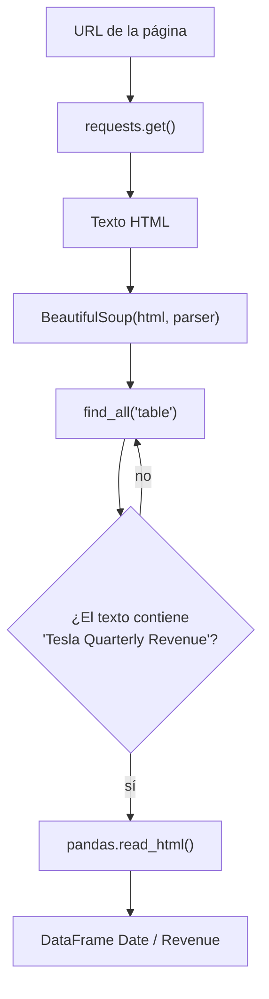

# 2 · Ingresos con web scraping

## Pasos
1. **Descargar**: `requests.get(url).text` devuelve el HTML como texto.
2. **Interpretar**: `BeautifulSoup(html, "html.parser")` construye un árbol navegable.
3. **Localizar la tabla correcta**: la página tiene varias (anual y trimestral); se elige por el título.
4. **Convertir**: `pandas.read_html` transforma la tabla HTML en DataFrame.

## Parsers de Beautiful Soup
| Parser | Cuándo usarlo |
|---|---|
| `html.parser` | Viene con Python, sin instalar nada |
| `lxml` | Muy rápido, tolera HTML defectuoso |
| `html5lib` | El más tolerante (se comporta como un navegador), más lento |

## Buenas prácticas
- Poner `timeout` y `raise_for_status()` en la petición.
- Respetar los términos de uso y no abusar de las peticiones.
- Elegir la tabla por su título, no por su posición: así no se rompe si la página cambia de orden.
