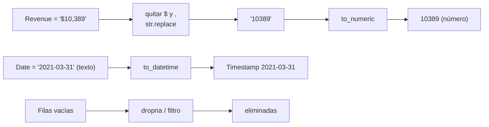

# 3 · Limpieza de datos



## Por qué es necesario
- `"$10,389"` es **texto**: no se puede sumar, ordenar ni dibujar.
- Una fecha en texto no se puede filtrar por rango ni usar como eje de tiempo.
- Las filas vacías rompen la conversión a número.

## Código
```python
df["Revenue"] = df["Revenue"].str.replace(r"[,$]", "", regex=True)   # equivale a ",|\$"
df["Date"] = pd.to_datetime(df["Date"])
df["Revenue"] = pd.to_numeric(df["Revenue"])
```

## Regex en 30 segundos
| Patrón | Significado |
|---|---|
| `,` | una coma |
| `\$` | un símbolo dólar (se escapa porque `$` es "fin de línea") |
| `[,$]` | "coma o dólar" |
| `,\|\$` | otra forma de decir "coma o dólar" |
