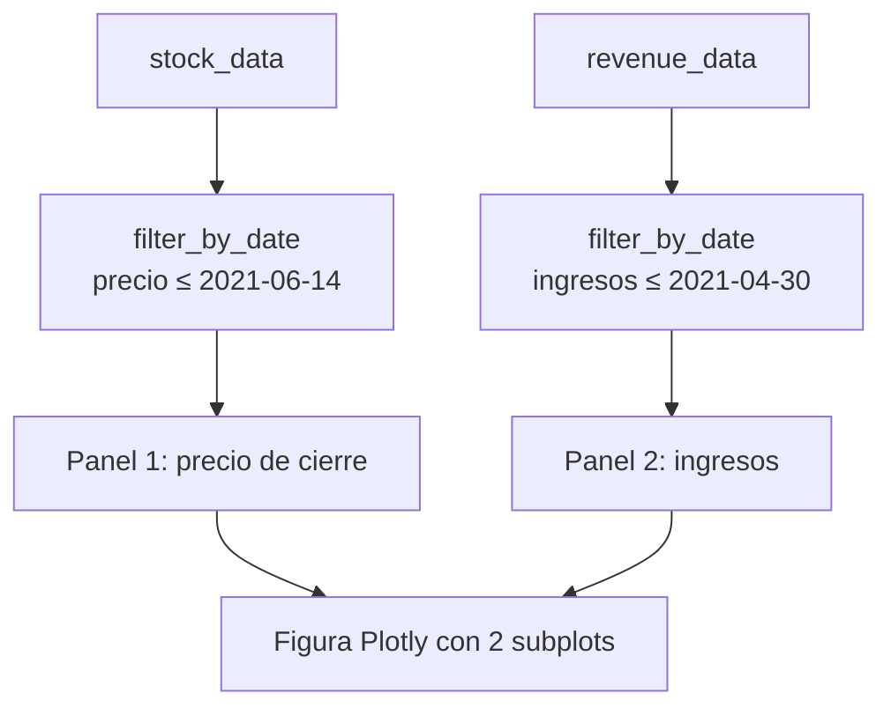

# 4 · Gráficos: precio frente a ingresos



## Idea
Dos paneles que comparten el eje de fechas permiten ver de un vistazo si el precio sube cuando suben los ingresos.

## Uso
```python
from stock_revenue.plotting import make_graph
make_graph(tesla_data, tesla_revenue, "Tesla").show()
make_graph(gme_data, gme_revenue, "GameStop").show()
```

`make_graph_png(...)` genera una imagen estática con matplotlib, útil para el README.

## Cómo leer los gráficos
| Qué mirar | Tesla | GameStop |
|---|---|---|
| Tendencia general | Precio e ingresos suben | Ingresos estables o a la baja |
| Pico de precio | Subida sostenida | Pico muy brusco a principios de 2021 |
| Conclusión | Precio acompaña al negocio | Precio desconectado del negocio |
