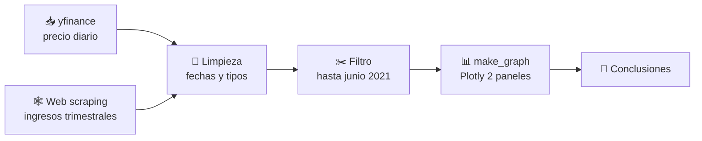
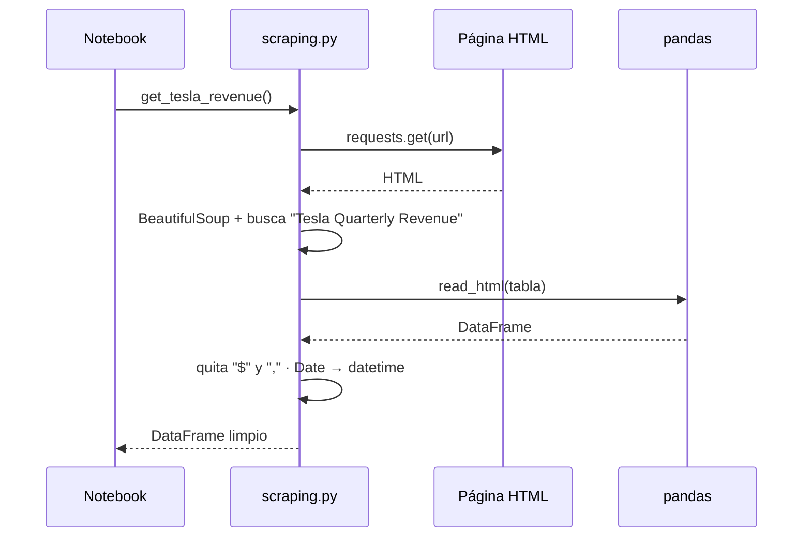

# 📈 Python Project for Data Science · Tesla vs GameStop

**Precio en bolsa + ingresos trimestrales + gráficos interactivos**, construido con `yfinance`, *web scraping* (`requests` + `BeautifulSoup`), `pandas` y `plotly`.

> Proyecto final del curso *Python Project for Data Science* (IBM · Coursera), reorganizado como un proyecto real: código modular, tests y documentación didáctica.


---

## 📑 Índice
1. [La pregunta que responde](#-la-pregunta-que-responde)
2. [Visión general del proceso](#-visión-general-del-proceso)
3. [Estructura del repositorio](#-estructura-del-repositorio)
4. [Cómo ejecutarlo](#-cómo-ejecutarlo)
5. [Cada proceso explicado](#-cada-proceso-explicado)
6. [Mapa de preguntas de la tarea](#-mapa-de-preguntas-de-la-tarea)
7. [Conceptos clave](#-conceptos-clave)
8. [Tests](#-tests)
9. [Limitaciones y siguientes pasos](#-limitaciones-y-siguientes-pasos)

## 🎯 La pregunta que responde
**¿El precio de una acción sigue a los ingresos de la empresa?** Se comparan dos casos opuestos: **Tesla**, donde precio e ingresos suben juntos, y **GameStop**, donde el precio se separa del negocio a principios de 2021.

## 🧭 Visión general del proceso





## 🗂 Estructura del repositorio

```
python-project-data-science/
├── notebooks/
│   └── Final_Assignment.ipynb     # ← la tarea resuelta, pregunta a pregunta
├── stock_revenue/                 # código reutilizable
│   ├── stocks.py                  #   precios con yfinance
│   ├── scraping.py                #   ingresos con BeautifulSoup
│   └── plotting.py                #   make_graph (Plotly) + versión PNG
├── tests/                         # tests sin red (HTML de ejemplo)
│   ├── fixtures/sample_revenue.html
│   └── test_scraping.py
├── docs/
│   ├── 01_yfinance.md
│   ├── 02_web_scraping.md
│   ├── 03_limpieza_de_datos.md
│   ├── 04_graficos.md
│   └── RESPUESTAS_CUESTIONARIO.md
├── requirements.txt
└── README.md
```

## 🚀 Cómo ejecutarlo

```bash
git clone https://github.com/TereBytes/python-project-data-science.git
cd python-project-data-science
python -m venv .venv && source .venv/bin/activate
pip install -r requirements.txt
jupyter notebook notebooks/Final_Assignment.ipynb
```

Necesita internet (yfinance y las páginas de ingresos). Para probar solo la lógica sin red: `python -m unittest discover -s tests -t .`

## 🔍 Cada proceso explicado

| Proceso | Qué hace | Guía |
|---|---|---|
| 1. Precios | Descarga el histórico diario de `TSLA` y `GME` | [docs/01_yfinance.md](docs/01_yfinance.md) |
| 2. Scraping | Extrae la tabla de ingresos trimestrales de una página HTML | [docs/02_web_scraping.md](docs/02_web_scraping.md) |
| 3. Limpieza | Quita `$` y comas, convierte fechas y números | [docs/03_limpieza_de_datos.md](docs/03_limpieza_de_datos.md) |
| 4. Gráficos | Dibuja precio e ingresos en dos paneles | [docs/04_graficos.md](docs/04_graficos.md) |

## 🗺 Mapa de preguntas de la tarea

| Apartado | Qué se pide | Dónde está |
|---|---|---|
| 1.1 | Subir el notebook | `notebooks/Final_Assignment.ipynb` |
| 1.2 | Primeras 5 filas de `tesla_data` | Pregunta 1 del notebook |
| 1.3 | Últimas 5 filas de `tesla_revenue` | Pregunta 2 del notebook |
| 1.4 | Primeras 5 filas de `gme_data` | Pregunta 3 del notebook |
| 1.5 | Últimas 5 filas de `gme_revenue` | Pregunta 4 del notebook |
| 1.6 | Gráfico de Tesla | Pregunta 5 del notebook |
| 1.7 | Gráfico de GameStop | Pregunta 6 del notebook |
| Cuestionario 2–8 | Parsers, `datetime`, limpieza, valores concretos, tendencias | [docs/RESPUESTAS_CUESTIONARIO.md](docs/RESPUESTAS_CUESTIONARIO.md) |

## 🧠 Conceptos clave

| Concepto | Idea en una línea |
|---|---|
| **DataFrame** | Tabla de pandas con filas y columnas |
| **Web scraping** | Leer datos de una página HTML con código |
| **Parser** | Motor que interpreta el HTML (`html.parser`, `lxml`, `html5lib`) |
| **Regex** | Patrón de texto, p. ej. `,|\$` = "coma o dólar" |
| **datetime** | Tipo de dato fecha: se puede ordenar, restar y filtrar |
| **Subplot** | Varios gráficos con el mismo eje de tiempo |
| **Fixture** | Datos de prueba fijos para que los tests no dependan de internet |

## 🧪 Tests
`python -m unittest discover -s tests -t . -v` → 9 tests (extracción de la tabla correcta, limpieza de símbolos, fechas, parsers, recorte de fechas, gráfico PNG).

## ⚠️ Limitaciones y siguientes pasos
- Los datos reales dependen de yfinance y de las páginas del curso; si cambian, los números de las preguntas 5 y 6 del cuestionario cambian con ellos.
- La fixture de los tests es **sintética** (solo imita la forma de la tabla).
- Ideas: correlación precio–ingresos, panel con Dash o Streamlit, más tickers, caché local de datos.
